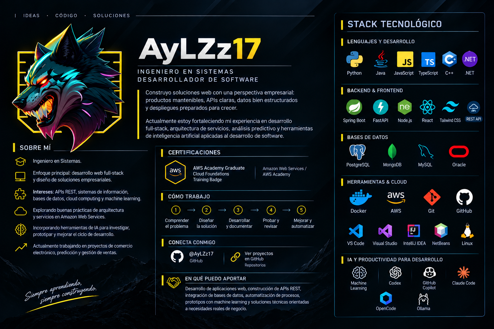

# AyLZz17

### Software Developer · Software Engineer

Desarrollo soluciones para aplicaciones web y APIs con enfoque empresarial, combinando arquitectura, datos, cloud y machine learning.

[GitHub](https://github.com/AyLZz17) · [Repositorios](https://github.com/AyLZz17?tab=repositories) · [📧 aylz.contact@gmail.com](mailto:aylz.contact@gmail.com) · [Portadolio Profesional](https://aylzz-profile.vercel.app)

## Perfil profesional

Como desarrollador de software, me enfoco en transformar necesidades reales en soluciones digitales claras, escalables y mantenibles. Mi experiencia e intereses abarcan el desarrollo Backend con conocimientos basicos en Frontend, la integración de bases de datos y la automatización de procesos.

Me interesa especialmente aplicar buenas prácticas de arquitectura, control de versiones, documentación y despliegue cloud para crear productos que aporten valor al negocio. Actualmente continúo fortaleciendo mis conocimientos en machine learning, AWS y herramientas de inteligencia artificial aplicadas al desarrollo.

Cuento con un nivel de inglés B1+ en continúo aprendizaje. 

## Stack tecnológico

### Lenguajes

### Backend y frontend

### Datos, cloud y herramientas

Tecnologías adicionales: DBeaver, Apache NetBeans,Codex, GitHub Copilot, Claude Code, OpenCode y Ollama.

## Proyectos en desarrollo

| Proyecto | Descripción |
| --- | --- |
| [Sistema de Predicción Crypto - XMR Monero](https://github.com/AyLZz17/SistemaPrediccionCrypto-XMRMonero) | Análisis y predicción de datos relacionados con Monero. |
| [Mai Repostería](https://github.com/AyLZz17/Mai-Reposteria-WebProject) | Aplicación web para una marca de repostería. |

### Stats

Siempre aprendiendo, construyendo y mejorando soluciones digitales.

